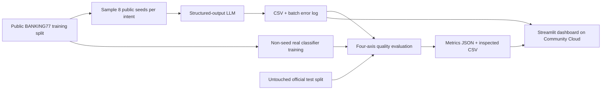

# 🧪 SynthLab — The Synthetic Data Factory

**MSAI-630 · Project 4 · University of the Cumberlands · Oct 23–25, 2026**

[Human audit](HUMAN_AUDIT.md) · [Sunday demo script](DEMO_RUNBOOK.md) · [OpenRouter $4.64 setup](OPENROUTER_SETUP.md) · [Team plan](MASTER_PLAN.md) · [Agent instructions](AGENTS.md) · [GitHub tasks](GITHUB_ISSUES.md) · [Deployment runbook](DEPLOYMENT.md) · [Evaluation definitions](EVALUATION_PLAN.md)

A **real Streamlit web app** that generates fictional banking customer queries with a language model and checks whether they are realistic, diverse, controllable, and different from their public source examples.

> **Research status:** Source code and automated offline tests are available. The project does **not** contain invented generation results or metrics. Until a team member runs an authenticated LLM experiment, the dashboard intentionally shows “Awaiting LLM run.”

## Architecture



### Stack

- **Dataset:** [BANKING77](https://github.com/PolyAI-LDN/task-specific-datasets), 10,003 official training and 3,080 official test examples, 77 intents, CC BY 4.0.
- **Subset:** `card_not_working`, `cash_withdrawal_charge`, `pending_transfer`, `card_arrival`, `compromised_card`, `declined_card_payment`.
- **Generator:** OpenRouter via OpenAI-compatible Python SDK, default `openai/gpt-4o-mini`, strict JSON-schema records. Original OpenAI credentials remain a fallback.
- **Backend/evaluation:** Python, pandas, TF-IDF, logistic regression, cosine distances; optional `all-MiniLM-L6-v2` embeddings on laptop or Colab.
- **Web app:** Free Streamlit Community Cloud; Docker/Railway remains available as a backup.
- **Persistence:** CSV and JSON committed only after validation. No Supabase required for this hackathon.
- **Coordination:** GitHub Issues #1–#12 and pull requests.

## Local setup

Python **3.11** recommended.

```bash
git clone https://github.com/abhay8046/synthlab-msai630-project4.git
cd synthlab-msai630-project4
python -m venv .venv
source .venv/bin/activate
pip install -r requirements.txt
cp .env.example .env
```

Set your own `OPENAI_API_KEY` **inside your local `.env`**, which is ignored by Git. Never send keys in chat, commit them, or include them in screenshots.

```bash
python -m pytest -q
streamlit run app.py
```

The app loads the public dataset and validates exact SHA-256 hashes. A network connection to the official raw CSV host is required.

## Understanding generation controls and avoiding repeats

- **Customer question categories** are selected BANKING77 intent labels such as `card_not_working` and `pending_transfer`. They decide *which banking problem* a generated question should concern.
- **Generate per category** is the requested number of synthetic texts per chosen intent. Six categories × 20 = 120 requested, not guaranteed valid outputs.
- **Public seed questions per category** picks a fixed, reproducible set of examples **from the official training split**. Eight selected seeds/intent form the evaluation reference pool. In each API batch the generator now rotates a random selection of up to five of those training examples as prompt context; the official test split is never used as prompting material.
- **Balanced evaluation** varies three tones × two length bands. With 20 questions/intent, each of six combinations receives examples. Even a four-question pilot now spans four distinct combinations.
- **Controlled live demo** forces a chosen tone (neutral/polite/frustrated) and length (short 8–20 words/detailed 25–55 words) across all generated questions.
- **Generation model** is normally locked to the OpenRouter model configured in private Streamlit Secrets. Higher-capability models can be tested by changing `OPENROUTER_MODEL` to a supported OpenRouter ID, e.g. `openai/gpt-4.1-mini`, and rebooting Streamlit. Do not switch the model *during* one formal 120-record experiment: it would confound comparisons and make provenance unclear.

### Duplicate protection (v3)

The generator now changes its everyday scenarios, rotates prompt examples, and includes a random variation ID per batch. After each API call, it removes exact/highly similar repeats against public seeds, already accepted records, and previous generation runs **within the same Streamlit session**. The app makes **at most one additional API call** to replace a shortfall per planned batch; errors and rejected counts are preserved in the batch log. If the model still duplicates, the output may contain fewer rows—this is the scientifically honest outcome. There is no permanent cross-session memory or semantic novelty guarantee. **Similarity at generation time is a conservative lexical screen**; the independent evaluation still measures quality and copying risk.

To compare different models fairly: run the same categories, public seeds, 20 examples/intent and evaluation methodology for each model, exporting a separate evidence ZIP per run. Avoid mixing different model outputs in one primary study unless the design explicitly calls for it.

## Run and export directly from Streamlit (no terminal required)

On the free Streamlit Community Cloud deployment, first generate **2 categories × 4 questions**, then evaluate them. Once that small live pilot works, use six categories × 20 records for the full study. The **Quality dashboard** now provides **Download complete experiment evidence ZIP**, including actual generated CSV, evaluated rows, failure rows, metrics, batch log and manifest. Save it immediately: Streamlit sessions are ephemeral. On a later session, use **Generate → Restore a saved study** to upload the ZIP and instantly recover the genuine dataset, four evaluation scores and failure explorer **without making another paid OpenRouter call**. Choose the same intent categories and seed count before restoring. See [STREAMLIT_DEPLOY.md](STREAMLIT_DEPLOY.md) and [OPENROUTER_SETUP.md](OPENROUTER_SETUP.md) for setup, key spending limits, and this browser-only workflow.

## Run the actual, reproducible experiment

```bash
python run_experiment.py --per-intent 20 --output-dir results/latest
```

The intended experiment is **6 intent labels × 20 requested records = 120**, *not* 120 guaranteed successful outputs. Shortfalls and API errors remain visible. The command creates the following files **only from actual model responses**:

```text
results/latest/
  synthetic_records.csv
  batch_log.csv
  evaluated_records.csv
  failure_records.csv
  metrics.json
  run_manifest.json
```

Or evaluate a real existing generated CSV without an API key:

```bash
python run_experiment.py --synthetic path/to/actual_questions.csv --output-dir results/latest
```

To measure embedding-space diversity and nearest neighbors offline (downloads a local MiniLM model):

```bash
pip install -r requirements-eval.txt
python run_semantic_evaluation.py --output-dir results/latest
```

This creates `semantic_metrics.json` and `semantic_evaluated_records.csv`, with explicit threshold and model metadata. Large model downloads are not part of the Railway runtime.

**Human audit:** `create_blind_audit.py` makes the blind questionnaire and a private answer key; `score_blind_audit.py` compares real/synthetic guesses and perceived tones. Keep the key private until all judgments are submitted.

After reviewing real outputs for identifiers, near-copy risks and dataset attribution, the team may commit **approved aggregate metrics and fictional data** under `results/latest/` for the reproducible Railway dashboard. Do **not** commit blind-audit answer keys.

## What the four scores mean

| Requirement | Primary measurement | Important limit |
|---|---|---|
| Fidelity | Held-out source-classifier ROC AUC | 0.5 indicates this classifier struggled, not proof of realism |
| Diversity | Duplicate rate, within-intent TF-IDF and optional MiniLM cosine distance | High dispersion alone is not high quality |
| Structure | Predicted requested intent, word-count adherence, separate human tone audit | An intent classifier can itself be wrong |
| Generalization | Exact matches and closest public seed cosine similarity | A near-copy threshold is **not** a privacy guarantee |

**Stretch:** train intent classifier on **synthetic only**, evaluate on unchanged real test set, and show real-trained baseline and accuracy gap. Real model accuracy, denominators and failure examples must be displayed alongside claims.

## Demo

The Streamlit app includes: Overview, Generate, Quality dashboard, Failure explorer, Human audit, Spot the fake, and Methods & safety. The **live demo** should generate a small batch; the **main evaluation** should load saved results from the frozen reproducible run. Record a video backup before Sunday.

## OpenRouter $4.64 API budget

We recommend a **dedicated OpenRouter API key capped at $2 total with no reset**, and **Auto Top-Up disabled**. Use OpenRouter model `openai/gpt-4o-mini` (~$0.15 per million input and ~$0.60 per million output tokens at the time of implementation). For a step-by-step setup, see [OPENROUTER_SETUP.md](OPENROUTER_SETUP.md). Store credentials in Streamlit Community Cloud Secrets, never GitHub. The app locks the OpenRouter model selection and caps output tokens per call.

## Free deployment: Streamlit Community Cloud

**Recommended for the residency demo:** follow [STREAMLIT_DEPLOY.md](STREAMLIT_DEPLOY.md) to deploy `main` / `app.py` from the private GitHub repository. Select Python 3.11 and add root-level TOML secrets in the Community Cloud console. Both the OpenRouter key and team password are required to unlock generation on Streamlit (legacy OpenAI keys can also work).

## Railway deployment

See [DEPLOYMENT.md](DEPLOYMENT.md). The root `Dockerfile` binds to Railway's dynamic `PORT`; the Streamlit health endpoint is `/_stcore/health`. Use Railway Variables:

```text
OPENAI_API_KEY=<secret; never commit>
OPENAI_MODEL=gpt-4o-mini
SYNTHLAB_GENERATION_PASSWORD=<strong team-only password>
```

Every hosted site stays **read-only** for generation without a password. The app and datasets are accessible, but API calls are disabled in that state.

## Ethics and license

Only public BANKING77 examples seed the model. Never paste bank customers’ real accounts into prompts. Synthetic text may still copy public examples or reproduce bias. The generator avoids sensitive identifiers and the evaluator flags possible copying, but **no threshold guarantees anonymity or safety for regulated data**.

Dataset attribution: Casanueva, I., Temcinas, T., Gerz, D., Henderson, M., & Vulić, I. (2020). *Efficient Intent Detection with Dual Sentence Encoders*. Second Workshop on NLP for Conversational AI. https://arxiv.org/abs/2003.04807. Data published by PolyAI under CC BY 4.0: https://github.com/PolyAI-LDN/task-specific-datasets.

The code is a course research prototype, not a commercial customer-data product.


## Blind human evaluation (human-generated results only)

From the **Human audit** tab, create a blind questionnaire of 20 real + 20 synthetic questions, matched by category. Download the blind sheet and privately save the answer key. Have two independent raters fill copies with anonymized IDs R1/R2. Upload their actual completed CSVs and compute real human source-guess, naturalness, tone-match and agreement results. Never present mock ratings as human findings. See [HUMAN_AUDIT.md](HUMAN_AUDIT.md).

The 11-slide, exactly 10-minute presentation script and Q&A checklist is at [DEMO_RUNBOOK.md](DEMO_RUNBOOK.md). Replace placeholders only after actual experiments are exported and inspected.
